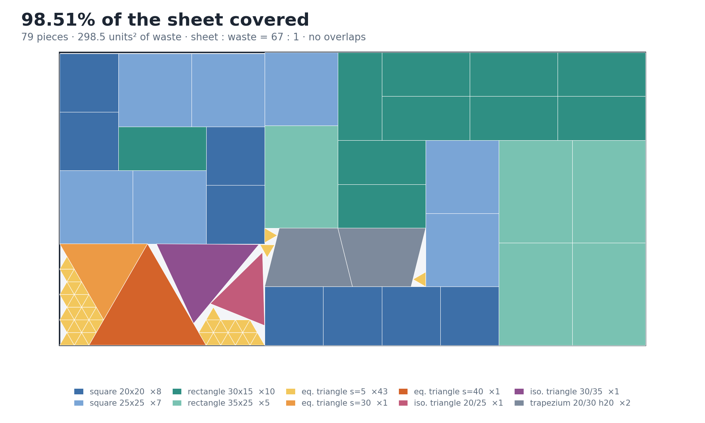
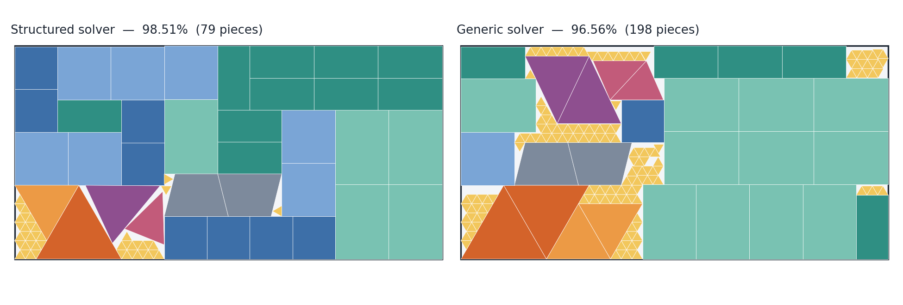
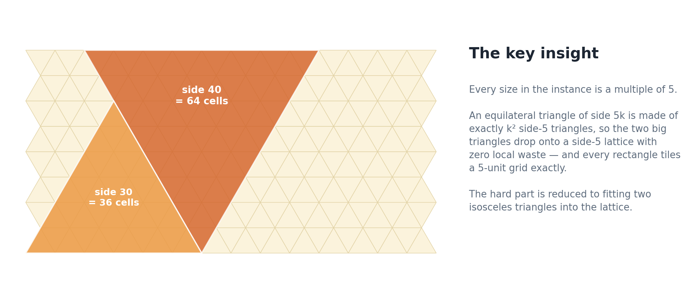
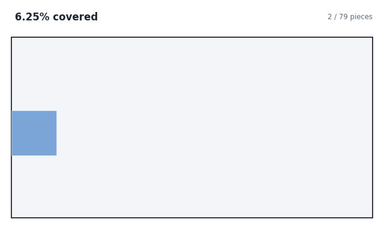
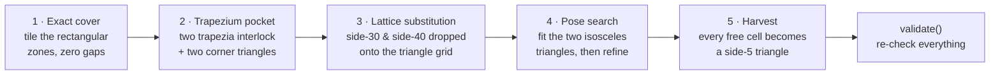
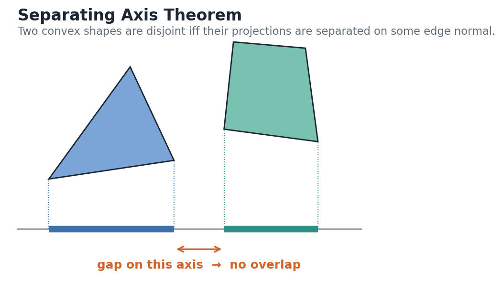
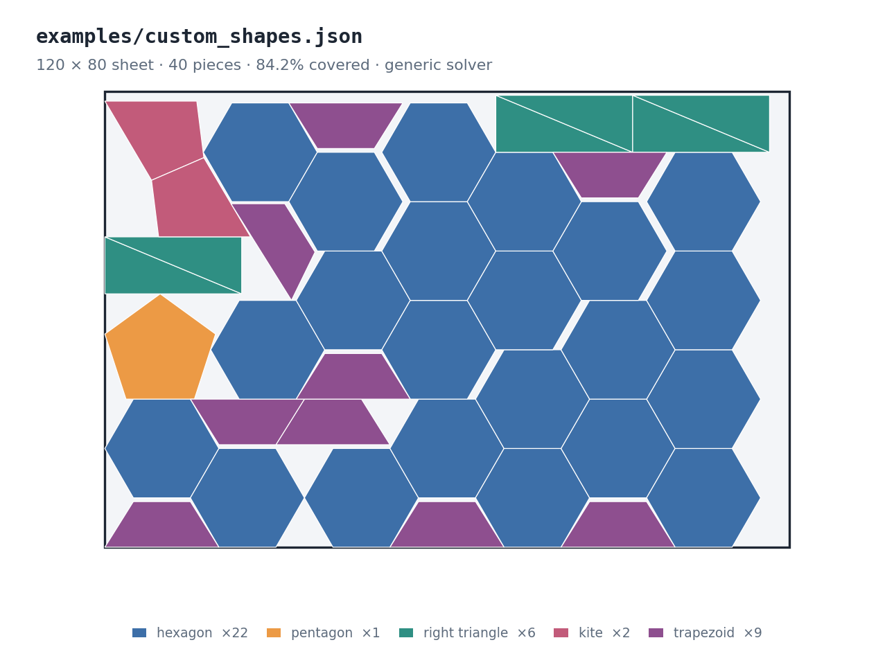

<div align="center">

# polynest

**Packing convex polygons onto a sheet — 98.51% coverage, every piece proven overlap-free.**

[](https://github.com/danialza/polynest/actions/workflows/tests.yml)
[](https://www.python.org/)
[](#)
[](LICENSE)



</div>

---

## The puzzle

Take a **200 × 100 sheet** and ten kinds of shape:

| | Shapes |
|---|---|
| Squares | 20 × 20, 25 × 25 |
| Rectangles | 30 × 15, 35 × 25 |
| Equilateral triangles | side 5, 30, 40 |
| Isosceles triangles | base/leg 20/25, 30/35 |
| Trapezium | parallel sides 20 and 30, height 20 |

Place every kind **at least once** — repeats are free — with **no overlaps**, and leave as little of the sheet empty as possible.

It's a small instance of *nesting*, the problem every laser cutter, CNC router and panel factory solves daily: cut parts out of a stock sheet and throw away as little material as you can. It is NP-hard, and the slanted edges make it awkward — rectangles tile beautifully, triangles leave slivers.

## Results

| Solver | Coverage | Waste | Sheet : waste | Pieces | Run time |
|---|---|---|---|---|---|
| **Structured** (default) | **98.51%** | 298.5 units² | **67 : 1** | 79 | ~24 s, deterministic |
| Generic (`--generic`) | 96.56% | 687.7 units² | 29 : 1 | 198 | 5 min on 12 cores |



Two solvers, two jobs. The **structured** solver squeezes the most out of *this* instance by exploiting its arithmetic. The **generic** solver assumes nothing about the shapes — hand it any convex polygons and it still packs them.

## The key insight



Look closely at the numbers: **every size is a multiple of 5.**

- Every rectangle tiles a 5-unit grid exactly.
- An equilateral triangle of side `5k` is built from exactly `k²` side-5 triangles — side 30 is **36 cells**, side 40 is **64 cells**. On a side-5 triangular lattice the two big triangles waste *nothing*.

So the sheet splits into a rectangular region (tiled perfectly) and a triangular band (filled perfectly), and the whole puzzle collapses to one hard question: **where do the two isosceles triangles go?** — the only shapes that fit neither grid.

## How the structured solver works

<div align="center">

</div>



1. **Exact cover.** A depth-first search over a bitmask of 5-unit cells tiles the rectangular zones with the four rectangle types, in both orientations, with no gaps. Branching always on the first empty cell keeps the search tiny.
2. **Trapezium pocket.** A 55 × 20 pocket is reserved where the two trapezia interlock (one turned 180°); two side-5 triangles fill its corners exactly.
3. **Lattice substitution.** Every lattice-aligned pose of the side-30 and side-40 triangles is enumerated; disjoint pairs are kept.
4. **Pose search.** The two isosceles triangles are sampled at continuous positions and angles — aimed at the centres of free cells, which finds tight pockets that uniform sampling misses — and scored by how few lattice cells they block. A joint rigid refinement then nudges the pair by sub-unit moves, keeping any move that frees a cell.
5. **Harvest.** Every lattice cell left untouched becomes a side-5 triangle, and a last pass squeezes in a few more.

The whole pipeline runs over 16 seeds and keeps the densest result. Same seed, same layout — every time.

## How the generic solver works

The generic solver never looks at *what* a shape is, only at its vertices. Shapes are data in one table; any convex polygon can go in.

- **Bottom-Left-Fill.** Each piece goes to the lowest, then left-most, free position. Candidate positions come from aligning a vertex of the new piece with a vertex of a placed one — in a tight packing, every piece rests against another piece or a wall.
- **Slide compaction.** After placement the piece slides down and left in shrinking steps, reaching pockets of irrational height under slanted edges that vertex alignment can never produce.
- **Pairing.** A triangle plus a copy of itself turned 180° is a parallelogram, and parallelograms pack far better than loose triangles. The solver may place either.
- **Parallel hill-climbing.** One layout is fully described by a small *genome* — insertion order, pair-or-single per shape, scan direction, orientation subset. Each CPU core runs an independent island that mutates its best genome and keeps improvements.

## Correctness first



Overlap is tested with the **Separating Axis Theorem**: two convex polygons are disjoint if and only if their projections are separated on at least one edge normal. It's exact, it needs no geometry library, and an axis-aligned bounding-box check rejects most pairs before it even runs. Pieces may touch — only real penetration counts.

Before any number is printed, `validate()` re-checks the final layout from scratch: every piece has its exact specified side lengths and area (to 10⁻⁶), lies inside the sheet, overlaps nothing, and every shape kind is present.

### Why not 100%?

Equilateral triangles have 60° angles and heights that are multiples of √3 — irrational. A region filled with triangles can never meet the straight, rational edge of the sheet flush, so a thin strip of waste is unavoidable. Here it is 0.36 units tall across the top-left. The rest of the 1.49% sits around the two isosceles triangles.

## Quick start

```bash
git clone https://github.com/danialza/polynest.git
cd polynest
pip install -r requirements.txt

python polynest.py                                   # structured solver → result.png
python polynest.py --generic --budget 60 --workers 8 # generic solver    → result_generic.png
python polynest.py --json layout.json                # also export every piece's vertices
python polynest.py --shapes examples/custom_shapes.json   # your own sheet and shapes
```

The solver itself uses only the Python standard library; matplotlib draws the picture.

### Options

| Flag | Solver | Default | Meaning |
|---|---|---|---|
| `--generic` | — | off | use the generic, any-convex-shape solver |
| `--shapes` | generic | — | load your own sheet and shapes from JSON |
| `--seed` | both | 1 / 7 | starting random seed |
| `--out` | both | `result.png` / `result_generic.png` | output image |
| `--json` | both | — | write the layout as JSON |
| `--restarts` | structured | 16 | seeds to try |
| `--budget` | generic | 520 | time budget in seconds |
| `--workers` | generic | 8 | parallel search islands |

## Bring your own shapes

The generic solver packs any convex polygons you give it — no code changes needed. Describe the sheet and the shapes in a JSON file:

```json
{
  "sheet": [120, 80],
  "shapes": {
    "hexagon":        [[5, 0], [15, 0], [20, 8.660254], [15, 17.320508], [5, 17.320508], [0, 8.660254]],
    "kite":           [[0, 0], [8, -6], [16, 0], [8, 14]],
    "right triangle": [[0, 0], [24, 0], [0, 10]],
    "trapezoid":      [[0, 0], [20, 0], [15, 8], [5, 8]],
    "pentagon":       [[0, 0], [12, 0], [15.708, 11.413], [6, 18.466], [-3.708, 11.413]]
  }
}
```

```bash
python polynest.py --shapes examples/custom_shapes.json --budget 60
```

<div align="center">

</div>

Every shape is placed at least once and checked like the bundled ones: each placed piece must keep the exact side lengths and area of its definition. Shapes must be convex — a non-convex one is rejected with a clear message. Vertex order and position don't matter.

Prefer code? The `SHAPES` table near the top of `polynest.py` is the only place shapes are defined; add a row there and areas, side lengths and validation follow automatically. The structured solver is purpose-built for the original ten shapes on a 200 × 100 sheet, so with any other shapes polynest switches to the generic solver on its own.

## Tested

```bash
pip install pytest && pytest -q
```

Thirteen tests run on every push (Python 3.10–3.13). Among them:

- **the record** — the structured solver must reproduce the 98.51% layout exactly, 79 pieces, all valid;
- **the insight** — every lattice-aligned side-30 / side-40 triangle covers exactly 36 / 64 cells;
- **the geometry** — SAT detects overlaps but lets pieces touch; a triangle and its 180° copy form a parallelogram;
- **the safety net** — `validate()` must reject overlapping pieces and a missing shape kind;
- **the command line** — a custom shapes file runs end to end, and a non-convex shape is refused.

## Project layout

```
polynest.py                 both solvers, validation, plotting, CLI — one file
examples/custom_shapes.json a ready-made custom instance
tests/                      pytest suite
docs/make_figures.py        renders every image and the animation in this README
docs/layouts/               the layouts shown above, as JSON
docs/img/                   README figures
```

Every figure is reproducible: export the layouts with `--json`, then run `python docs/make_figures.py`.

## License

[MIT](LICENSE) © Danial Zafaranchizadeh Moghaddam
